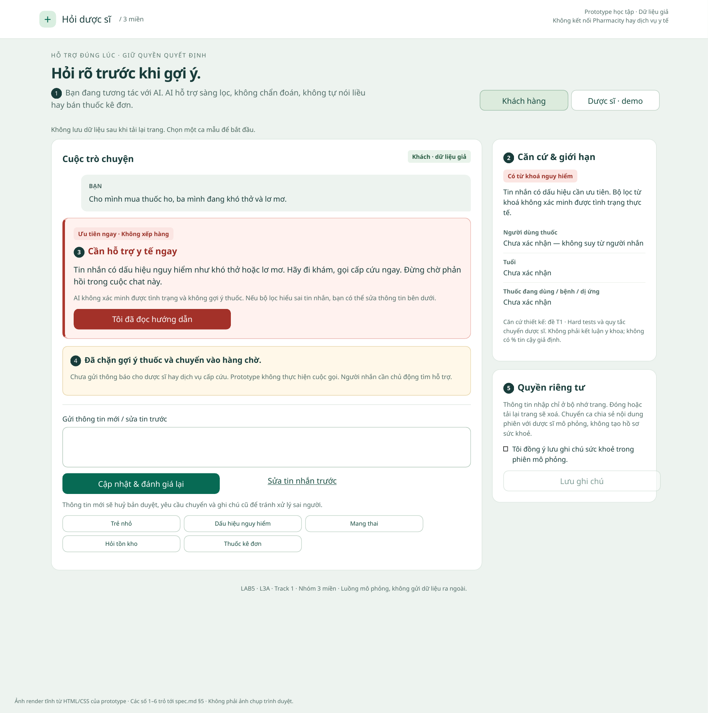
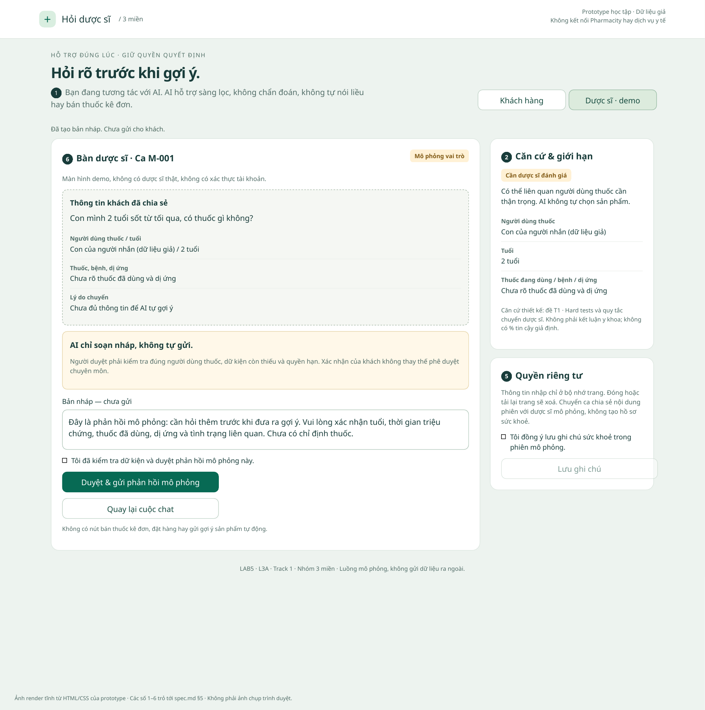

# Prototype — Hỏi dược sĩ · Nhóm 3 miền

## Mở và thử

Mở `index.html` bằng Chrome, Edge hoặc Firefox. Không cần cài đặt, backend hay API key. Hoặc chạy từ thư mục repo:

```bash
python3 -m http.server 8080
```

Sau đó mở `http://localhost:8080/prototype/`.

Có đúng hai màn hình: **Khách hàng** và **Dược sĩ · demo**. Thanh điều khiển demo tách khỏi cuộc chat; cho phép giả lập quá hạn và xoá phiên.

## Demo phần của Hậu

### Ca 1 — Trẻ nhỏ, cần dược sĩ

1. Chọn **Trẻ nhỏ**. AI không chọn thuốc; bảng căn cứ hiện các thông tin chưa xác nhận.
2. Mở **Bổ sung / sửa người dùng thuốc**, điền thông tin giả rồi cập nhật.
3. Chọn **Chuyển dược sĩ**. Có thể **Huỷ chuyển ca** khi chưa được nhận.
4. Mở **Dược sĩ · demo** → **Nhận ca mô phỏng** → **Soạn phản hồi sàng lọc**.
5. Kiểm tra bản nháp, tích xác nhận → **Duyệt & gửi phản hồi mô phỏng**.
6. Quay lại **Khách hàng**, thấy phản hồi đã duyệt. Không có đơn hàng hay gợi ý thuốc tự động được tạo.

### Ca 2 — Dấu hiệu nguy hiểm lẫn yêu cầu mua thuốc

1. Chọn **Dấu hiệu nguy hiểm**. Cảnh báo đi khám / gọi cấp cứu hiện ngay.
2. Không có nút chuyển hàng chờ hay gợi ý thuốc. Bàn dược sĩ không nhận ca này.
3. Chọn **Tôi đã đọc hướng dẫn** chỉ ghi nhận đã đọc, không giả vờ gọi cấp cứu hay báo dược sĩ.
4. Có thể **Sửa tin nhắn trước** rồi **Cập nhật & đánh giá lại** nếu bộ lọc hiểu sai.

### Kiểm tra thêm

- **Quá hạn:** chuyển ca rồi bấm **Giả lập quá hạn 2 phút**. Bản nháp không được tự gửi. Có thể thử chuyển lại. Nếu không giả lập, bộ hẹn giờ thực sự chạy 2 phút từ lúc chuyển ca, gồm cả thời gian dược sĩ đang xem.
- **Sửa ca:** đang chờ hoặc đã duyệt, gửi thông tin mới có “khó thở”. Ca cũ, bản duyệt và đồng ý lưu bị huỷ; cảnh báo nguy hiểm thay thế luồng cũ.
- **Quyền riêng tư:** nút lưu bị khoá trước khi tích đồng ý; lưu xong có nút xoá. Mọi dữ liệu chỉ ở bộ nhớ phiên, không dùng localStorage/cookie và không gửi ra mạng.
- **Ca thường:** chọn **Hỏi tồn kho**. AI nói rõ không có nguồn giá/tồn kho; không tự xác nhận còn hàng.
- **Thuốc kê đơn:** không có nút bán hoặc gợi ý thay thế.
- **Ca lạ:** nhập văn bản tự do. Nếu không nhận diện được, hệ thống hỏi lại và cho chuyển dược sĩ; không sinh câu trả lời y khoa.

## Ảnh đánh số

Đây là **ảnh render tĩnh từ cùng hàm HTML và CSS của prototype**, có điều chỉnh bố cục in; không phải ảnh chụp trình duyệt và không xác minh tương tác trên trình duyệt.





Ánh xạ từng số và lý do thiết kế ở [`spec.md` §5](../spec.md#5-prototype--chặng-5).

## Những gì là mô phỏng

- Phân luồng bằng quy tắc từ khoá trong `app.js`, **không có lời gọi AI thật**.
- Dược sĩ, hàng chờ, hạn 2 phút, chuyển ca, duyệt và lưu ghi chú đều là mô phỏng trên một trang. Hạn 2 phút là lựa chọn demo, không phải cam kết của Pharmacity.
- Không có phân quyền thật; nút đổi vai chỉ phục vụ demo. Không dùng mô hình này để triển khai hồ sơ sức khoẻ thật.
- Không kết nối Pharmacity, tồn kho, đơn hàng hay dịch vụ cấp cứu. Không có thuốc thật, liều dùng hoặc chức năng mua hàng.
- Luồng duyệt minh hoạ **phản hồi sàng lọc**, chưa có màn hình dược sĩ chọn sản phẩm. Quyền cho `goi_y_san_pham` cần Huy chốt trong §4.

## Giới hạn và bàn giao

Bộ lọc không hiểu đầy đủ phủ định, tiếng lóng hoặc mọi dấu hiệu y tế. Ví dụ “không khó thở” vẫn có thể kích hoạt cảnh báo; câu diễn đạt khác có thể bị bỏ sót. Ca không nhận diện được luôn đi đường hỏi lại/chuyển người, nhưng điều đó **không bảo đảm phát hiện cấp cứu**. Đây là giới hạn demo, không phải hệ thống phân loại y tế dùng thật.

Câu chữ và quyền hiện tại là giả định để Hậu dựng prototype. Thịnh cần đối chiếu §3 và chọn nguyên tắc; Huy cần chốt §4, thời hạn và tiêu chí §6. Chưa ghi thay ý kiến thảo luận hoặc kết quả demo của nhóm.

## Kiểm tra kỹ thuật

```bash
npm ci
npm test
```

17 kiểm tra: 13 kiểm tra logic và 4 kiểm tra DOM bằng jsdom. Kiểm tra các nhánh nguy hiểm, duyệt, quá hạn, sửa dữ kiện, đồng ý lưu và chèn HTML. jsdom không phải trình duyệt thật và không kiểm tra layout responsive, focus/scroll thực tế hay bộ hẹn giờ bằng thời gian thực.

Hai ảnh đã được render và xem lại để kiểm tra bố cục. Môi trường thực hiện không có trình duyệt khả dụng; cần bấm thử một vòng trên trình duyệt trước khi demo trước lớp.

Tái tạo HTML cho ảnh (không cần jsdom):

```bash
node prototype/scripts/render-snapshots.cjs /tmp/lab5-snapshots
```

Dùng WeasyPrint 70.0 để render hai file HTML thành PDF tạm, rồi Poppler `pdftoppm -scale-to 1800 -singlefile -png` để xuất PNG. Script dùng cùng `render()` với ứng dụng; PDF tạm không đưa vào bài nộp.
