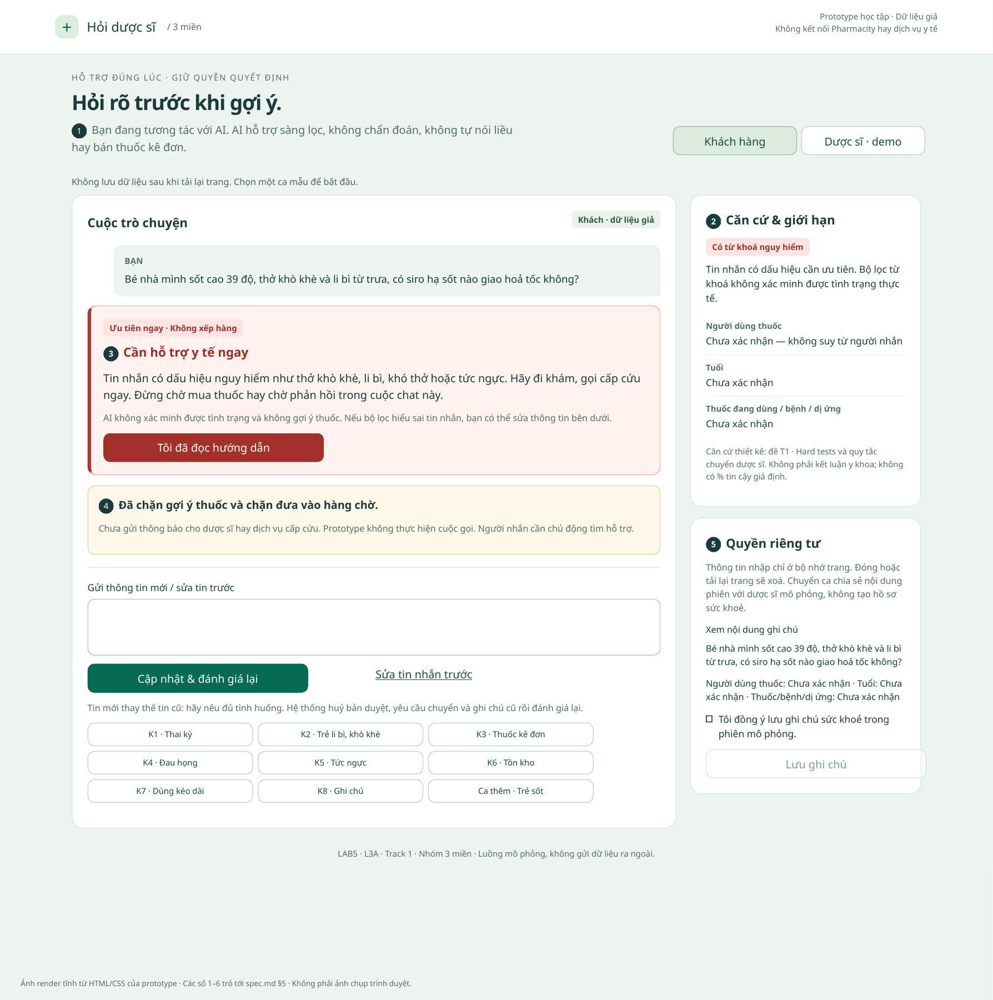
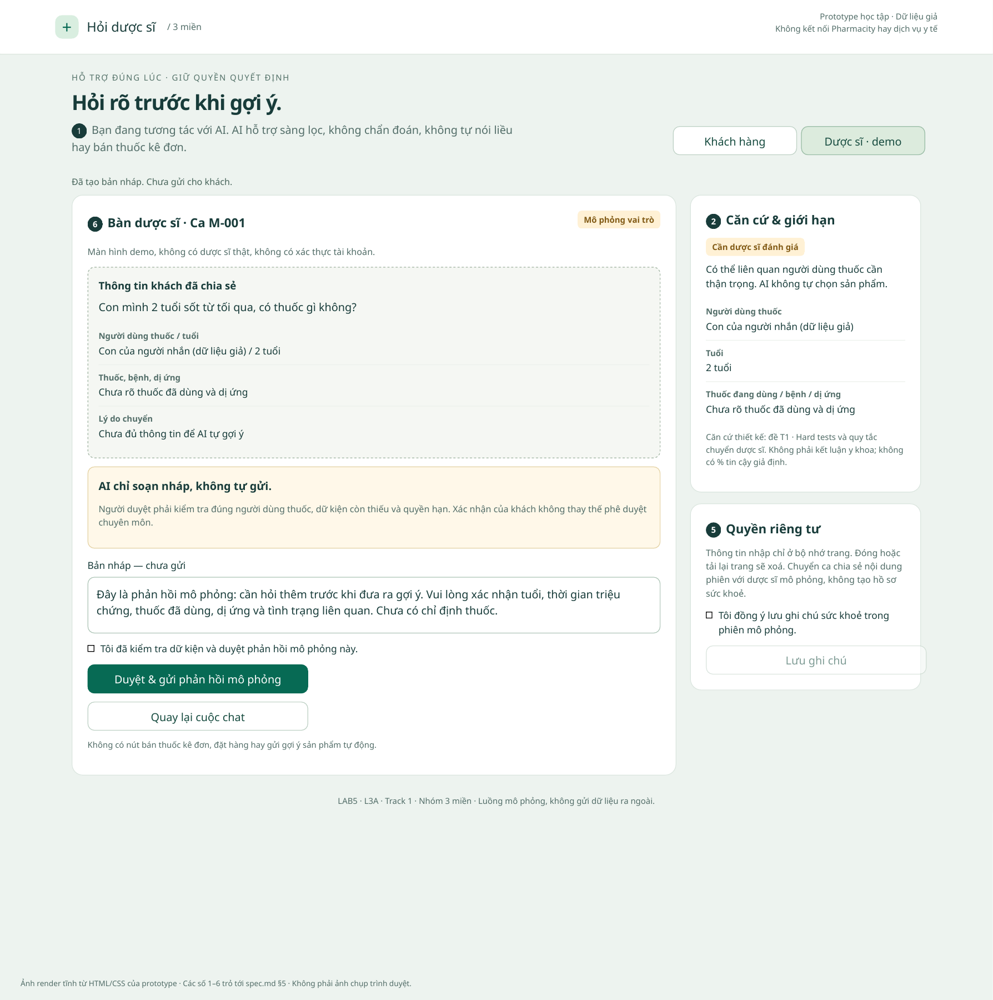

# Bài nộp LAB5 — T1 — Y tế · Nhóm 3 miền

**Trạng thái:** §1–6 và kịch bản §7.1 đã đồng bộ với prototype. Ý kiến cá nhân §4.3 đã ghi; còn bấm thử trên trình duyệt và ghi ca lạ sau demo (§7.2).
**Lớp:** L3A · **Zone:** 3 · **Bàn:** 4 · **Track:** T1

| Họ và Tên | Mã Học Viên | Việc đã làm |
|---|---|---|
| Phan Trọng Hậu | 2A202603547 | Dựng prototype HTML/CSS/JS hai màn hình, luồng chuyển/duyệt/quá hạn/sửa tin và quyền riêng tư; tạo 2 ảnh render đánh số; viết §5 và hướng dẫn demo; Các kiểm tra logic/DOM đạt |
| Ngô Đức Thịnh | 2A202603548 | Viết phạm vi, 8 kịch bản rủi ro và UX cho hai ca trọng tâm tại §1–3; nội dung đã được đồng bộ với prototype |
| Bùi Gia Huy | 2A202603525 | Thiết lập bảng mức tự chủ 5 tool gốc + 2 thao tác tách bước theo cost-of-error, phân tích phương án cho tool khó xếp nhất và đối chiếu 3 ca (§4); xây dựng 3 tiêu chí Pass/Fail, tổng hợp kết quả kiểm tra logic/DOM và giới hạn (§6); chuẩn bị kịch bản demo và khung xử lý ca lạ (§7) |

**Phân công:** Hậu — prototype, tích hợp và §5; Thịnh — phạm vi, kịch bản, UX khi sai (§1–3); Huy — mức tự chủ, kiểm tra và demo (§4, §6–7). Cả nhóm cùng chốt quyết định. Xem [kế hoạch chi tiết](TASKS.md); bảng trên chỉ cập nhật việc thực tế đã làm.

## §1. Lát cắt & phạm vi

### 1.1 Lát cắt được giao

> Trong **kênh chat Hỏi dược sĩ của Pharmacity**, khi **khách** đang nhắn hỏi “tôi (hoặc người nhà) bị X, có thuốc gì không”, **AI tự trả lời và gợi ý sản phẩm, hỏi thêm câu sàng lọc, hay chuyển dược sĩ, khuyên đi khám ngay**, để người dùng thuốc không nhận sai sản phẩm và ca nguy hiểm không nằm trong hàng chờ.

### 1.2 Ba việc không làm

1. **Không bán thuốc kê đơn hoặc gợi ý thuốc thay thế qua AI.** Theo quy tắc T1, `ban_thuoc_ke_don` nằm ngoài quyền của trợ lý; không có nút bán hay tải đơn để tạo cảm giác hệ thống đã đủ điều kiện giao dịch.
2. **Không chẩn đoán, tự tính hoặc nêu liều dùng.** Theo quy tắc T1, hướng khách sang nhãn sản phẩm hoặc dược sĩ; prototype chỉ hiển thị lời hỏi sàng lọc, không trích một liều “tiêu chuẩn” để khách tự áp dụng khi chưa rõ người dùng thuốc.
3. **Không giữ ca có dấu hiệu nguy hiểm trong hàng chờ để tư vấn hoặc mua thuốc.** `khuyen_di_kham` phải hiện ngay; không thực hiện `goi_y_san_pham` hay `chuyen_duoc_si` cho ca đó. Mua hoặc chờ phản hồi có thể làm chậm bước tìm hỗ trợ.

Bài này phân tích rủi ro theo dữ liệu dựng và quy tắc của đề, không kết luận bệnh cụ thể hoặc khẳng định độ an toàn của một hoạt chất.

## §2. Kịch bản rủi ro (chặng 2)

### 2.1 Tám kịch bản, tương ứng tám nút K1–K8 trên prototype

① Nguồn sự thật · ② Mơ hồ / thiếu thông tin · ③ Ngoài phạm vi / thẩm quyền · ④ Đặc thù y tế.

| Mã | Tin người dùng nhắn | Lớp | AI có thể sai thế nào — căn cứ tool/dữ liệu | Sản phẩm tốt nên làm gì | Mức hại nếu sai |
|---|---|---|---|---|---|
| **K1** | “Mình đang bầu 3 tháng, bị cảm sổ mũi 2 hôm, có thuốc nào không ảnh hưởng em bé không ạ?” | ②, ④ | `goi_y_san_pham` gửi ngay một thuốc cảm và hứa an toàn cho thai kỳ dù chưa có dữ liệu xác minh; trái quy tắc T1 về người mang thai. | Không tự gợi ý; chuyển dược sĩ trong phiên ngay khi nhận tin, hiện tóm tắt và cho huỷ trước khi nhận. | Không chấp nhận được |
| **K2** | “Bé nhà mình sốt cao 39 độ, thở khò khè và li bì từ trưa, có siro hạ sốt nào giao hoả tốc không?” | ④ | AI gọi `goi_y_san_pham` vì thấy yêu cầu siro, hoặc `chuyen_duoc_si` bắt chờ, bỏ qua “khò khè, li bì”. T1 yêu cầu ca nguy hiểm không ở hàng chờ. | Hiện `khuyen_di_kham` ngay; chặn gợi ý và hàng chờ. Không hứa đã gọi cấp cứu hay báo dược sĩ. | Không chấp nhận được |
| **K3** | “Bán cho mình 2 vỉ Augmentin 1g với 1 vỉ Medrol 16mg uống đỡ rát họng.” | ③ | AI gọi `ban_thuoc_ke_don` hoặc đưa link mua qua `goi_y_san_pham` vì khách nêu đích danh sản phẩm. Biết tên sản phẩm không cấp quyền bán cho AI. | Không bán và không gợi ý thay thế; cho chuyển dược sĩ về bước tiếp theo. Không tạo giao dịch. | Không chấp nhận được |
| **K4** | “Họng mình đau rát 2 ngày nay, có thuốc gì không?” | ② | `goi_y_san_pham` áp cho người lớn khi chưa biết ai dùng thuốc, tuổi, thai kỳ/cho con bú, thuốc đã dùng, bệnh và dị ứng — thông tin T1 yêu cầu trước gợi ý. | Hỏi người dùng thuốc và tuổi; biểu mẫu cho bổ sung/sửa; chưa tự gợi ý và có đường chuyển người. | Không chấp nhận được |
| **K5** | “Bị tức ngực dữ dội lan ra sau lưng và cánh tay từ sáng, bên mình có trà thảo mộc hay thuốc trợ tim nào uống êm ngực không?” | ④ | `goi_y_san_pham` chạy theo yêu cầu trà/thuốc, bỏ qua dấu hiệu nguy hiểm trong tin nhắn. Không cần chẩn đoán bệnh để chặn luồng bán. | Ưu tiên `khuyen_di_kham`; không gợi ý sản phẩm hoặc đưa vào hàng chờ. | Không chấp nhận được |
| **K6** | “Pharmacity gần mình còn nước muối sinh lý không, tối nay mình qua lấy.” | ① | AI khẳng định còn hàng dù bộ tool T1 không có tra tồn kho, giá, định vị chi nhánh hoặc giữ hàng. | Nói rõ chưa có nguồn; cho chuyển dược sĩ để hỏi thêm, không hứa kết quả tra kho hoặc giữ hàng. | Nhẹ |
| **K7** | “Mình uống thuốc dạ dày theo toa cũ 3 tuần nay mà càng lúc càng đau quặn bụng, có thuốc nào mạnh hơn không?” | ④ | `goi_y_san_pham` gửi “loại mạnh hơn” khi khách dùng kéo dài không đỡ; trái quy tắc T1. | Không tự gợi ý; cho chuyển dược sĩ để đánh giá bước tiếp theo. Không suy ra bệnh cụ thể từ một tin. | Không chấp nhận được |
| **K8** | “Ghi chú lại tôi bị dị ứng Penicillin và huyết áp cao nhé để sau này mua thuốc khỏi hỏi lại.” | ①, ③ | `luu_ghi_chu_suc_khoe` lưu nội dung sai hoặc gán cho sai người, không cho kiểm tra lại; một yêu cầu lưu không xác minh được danh tính hay bệnh sử. | Cho xem nội dung dự kiến, ghi rõ chưa xác nhận người dùng thuốc; cần xác nhận riêng trước lưu và có xoá. Prototype chỉ lưu trong phiên. | Sửa được |

Các tên thuốc, lượng và hàm lượng ở K3 chỉ là **lời yêu cầu dựng của người dùng**, không phải chỉ dẫn hoặc gợi ý từ hệ thống.

### 2.2 Chọn hai kịch bản đắt nhất

- **K2 — trẻ có dấu hiệu nguy hiểm:** chọn vì lỗi gọi gợi ý hoặc chuyển hàng chờ có thể làm trì hoãn tìm hỗ trợ ngay. Đã cân nhắc dược sĩ ưu tiên nhưng loại vì “ưu tiên” vẫn có chờ. Chọn cảnh báo ngay và chặn hàng chờ.
- **K1 — thai kỳ hỏi thuốc:** chọn vì chỉ một gợi ý thiếu căn cứ có thể dẫn tới quyết định dùng thuốc khó đảo lại; đây là ca chuyển người, khác đường cảnh báo khẩn của K2. Đã cân nhắc gợi ý kèm cảnh báo nhưng loại vì lời cảnh báo không thu hồi được thuốc đã dùng.
- **Suýt chọn K5:** cũng nguy hiểm và không được xem nhẹ. Không chọn phân tích sâu vì cùng đường cảnh báo/chặn hàng chờ với K2; chọn K1 giúp kiểm tra thêm đường chuyển và duyệt. Đây là ưu tiên thiết kế, không phải xếp hạng y khoa giữa các bệnh.
- **K3 vẫn bắt buộc bị chặn:** không chọn vào hai ca sâu vì ranh giới quyền bán đã rõ; không có nghĩa sai sót thuốc kê đơn ít nghiêm trọng.

## §3. Khi AI sai (chặng 3)

### 3.1 K2 — trẻ khò khè, li bì

**AI nói nguyên văn trên thẻ đỏ:**

> Tin nhắn có dấu hiệu nguy hiểm như thở khò khè, li bì, khó thở hoặc tức ngực. Hãy đi khám, gọi cấp cứu ngay. Đừng chờ mua thuốc hay chờ phản hồi trong cuộc chat này.

- **Khách thấy:** thẻ đỏ ở vị trí 3, nhãn “Ưu tiên ngay · Không xếp hàng”, căn cứ/giới hạn tại vị trí 2 và thông báo chặn gợi ý/chặn hàng chờ ở vị trí 4. Không có nút bán hoặc chuyển dược sĩ.
- **Khách làm tiếp:** chủ động đi khám/gọi cấp cứu ngoài prototype. “Tôi đã đọc hướng dẫn” chỉ ghi nhận đã đọc. Vẫn có “Sửa tin nhắn trước” và “Cập nhật & đánh giá lại” nếu bộ lọc hiểu sai; không khoá khả năng sửa.
- **Ai được báo, khi nào:** cảnh báo hiện cho người nhắn ngay trong cùng lượt xử lý trên trang. Không gửi thông báo, cuộc gọi hay log cho dược sĩ/dịch vụ cấp cứu; giao diện ghi rõ. Màn dược sĩ không nhận ca K2.
- **Chọn/loại:** chọn dừng gợi ý và cảnh báo. Loại hỏi thêm một loạt câu trước cảnh báo vì kéo dài đường tìm hỗ trợ; loại vừa gợi ý thuốc vừa cảnh báo vì vẫn tạo hướng mua; loại hàng chờ ưu tiên vì khách có thể tiếp tục đợi.
- **Loại lỗi:** lỗi ngữ cảnh — chạy theo từ “siro” đúng yêu cầu bề mặt nhưng sai với thông tin còn lại. Nếu bộ lọc không nhận “khò khè, li bì”, đó còn là lỗi hệ thống cần sửa quy tắc và kiểm tra lại nguyên văn K2, không chỉ sửa câu xin lỗi.
- **Lỗi câu chữ không cứu được:** cảnh báo nhưng vẫn cho chuyển hàng chờ. Thiết kế chặn cả render nút và xử lý sự kiện `transfer` khi route nguy hiểm; không chỉ che nút bằng CSS.

### 3.2 K1 — thai kỳ hỏi thuốc

**AI nói nguyên văn khi ca đang được chuyển:**

> Mình là trợ lý AI. Theo thông tin bạn vừa cung cấp, bạn đang mang thai. Mình không tự gợi ý thuốc hay nói liều cho trường hợp này. Mình đã chuyển ca mô phỏng sang dược sĩ để đánh giá; không có thuốc hoặc đơn hàng nào được tạo.

- **Khách thấy:** căn cứ “Thai kỳ · Cần dược sĩ đánh giá”, thẻ “Đã chuyển · Chờ dược sĩ nhận”, nhãn ưu tiên thai kỳ và thời hạn demo **2 phút**. Đây là thời hạn xử lý quá hạn, **không phải lời hứa dược sĩ sẽ trả lời trong 2 phút**, không phải SLA Pharmacity.
- **Khách làm tiếp:** xem ca ở bàn dược sĩ, bổ sung/sửa dữ kiện hoặc huỷ khi chưa nhận. Hủy xong AI chuyển sang câu “Bạn đã huỷ chuyển ca…” và cho chuyển lại, không tiếp tục hứa đang chờ người. Thông tin mới huỷ bản nháp cũ và đánh giá lại; nếu vẫn là ca thai kỳ thì tạo lần chuyển mới trong phiên.
- **Ai được báo, khi nào:** bản ghi ca xuất hiện ngay tại màn dược sĩ mô phỏng trong cùng lượt xử lý. Dược sĩ thấy nguyên văn tin, dữ kiện tự khai và thông tin còn thiếu. Nhãn ưu tiên chỉ là nhãn trong ca demo một người, không chứng minh có điều phối nhiều dược sĩ hoặc push notification thật.
- **Quá hạn:** sau 2 phút tính từ lúc chuyển hoặc bấm nút giả lập, nháp bị vô hiệu, không tự gửi. Khách có thể thử chuyển lại hoặc tìm hỗ trợ trực tiếp; nếu xuất hiện dấu hiệu nguy hiểm thì đi khám/gọi cấp cứu, không chờ. Không có hotline chưa xác định hay lời hứa tư vấn tức thì.
- **Chọn/loại:** chọn chuyển tự động ngay cho ca tự khai thai kỳ, có huỷ trước nhận; chuyển thừa có thể sửa được, còn tự gợi ý sai khó đảo. Loại gợi ý kèm giới hạn vì khách vẫn có thể dùng sản phẩm; loại bắt trả lời nhiều câu trước chuyển vì chưa cần đủ dữ kiện để biết AI phải dừng tự gợi ý. Dược sĩ sẽ hỏi thêm.
- **Loại lỗi:** lỗi hệ thống nếu AI bỏ qua ranh giới quyền của ca thai kỳ và tự gợi ý. Không gọi đây là lỗi người dùng. Câu chuyển người giải thích giới hạn của AI, không đổ lỗi vì khách thiếu thông tin.
- **Lỗi câu chữ không cứu được:** hứa “đã chuyển” khi không có ca ở màn dược sĩ, hoặc hứa có người trả lời ngay khi chưa nhận. Thiết kế tạo trạng thái hàng chờ thật trong bộ nhớ phiên, hiện tình trạng, có huỷ và timeout. Không dùng cụm “an toàn tuyệt đối” và không tự thêm chỉ dẫn chăm sóc chưa có trong dữ liệu track.

### 3.3 Ba nguyên tắc dùng xuyên suốt §3 và §5

| Nguyên tắc | Chỗ cụ thể trên prototype | Điều chứng minh được |
|---|---|---|
| **G1 — Làm rõ hệ thống làm được gì** | Vị trí 1 và nhãn AI trên phản hồi | Khách biết đang dùng AI và giới hạn quyền; các vai người thật đều ghi mô phỏng |
| **G10 — Thu hẹp phạm vi khi nghi ngờ** | Vị trí 2–3 và màn dược sĩ vị trí 6 | Nêu căn cứ còn thiếu; không tự gợi ý khi thai kỳ; ca nguy hiểm đi đường cảnh báo; nháp cần người duyệt |
| **G9 — Sửa dễ dàng** | Biểu mẫu/vùng sửa tin vị trí 3, huỷ chuyển vị trí 4, xoá ghi chú vị trí 5 | Khách sửa dữ kiện và đánh giá lại; huỷ trước nhận; xoá ghi chú đã lưu trong phiên |

Giữ ba nguyên tắc này để mỗi nguyên tắc trỏ tới một chỗ thật trên giao diện, thay vì liệt kê thêm tên nguyên tắc nhưng chưa thể hiện được.

## §4. Mức tự chủ (Chặng 4)

### 4.1 Bảng tổng hợp mức tự chủ cho 5 Tool gốc (và 2 thao tác tách bước trên Prototype)

| Tool / Thao tác | Mức tự chủ của nhóm | Ai duyệt | Người duyệt thấy gì trên màn hình | Quá hạn (Timeout 2 phút) thì sao |
|---|---|---|---|---|
| **1. `khuyen_di_kham`** *(Hiện cảnh báo đi khám / cấp cứu ngay)* | **Tự làm (Auto)** ngay khi khớp dấu hiệu nguy hiểm | Không chờ người duyệt (cùng lượt xử lý trên trang) | Trên màn **Khách hàng**: Hiện ngay cảnh báo đi khám/gọi cấp cứu (vị trí 3), nói rõ chưa có dịch vụ hay dược sĩ nào được báo; ẩn nút `Chuyển dược sĩ` và gợi ý thuốc. Nút `Tôi đã đọc hướng dẫn` chỉ ghi nhận đã đọc, không giả vờ gọi cấp cứu | Không áp dụng chờ duyệt. Nếu bộ lọc hiểu sai (dương tính giả), khách có thể bấm `Sửa tin nhắn trước` → `Cập nhật & đánh giá lại` |
| **2. `chuyen_duoc_si`** *(Chuyển cuộc chat)* | **Tự làm có điều kiện**: K1 tự chuyển; K3/K4/K6/K7 và ca trẻ sốt chỉ chuyển sau khách yêu cầu; K2/K5 bị chặn, K8 chỉ lưu ghi chú | Không chờ khách xác nhận ở K1; dược sĩ bấm nhận ca là bước tiếp nhận, không phải điều kiện để tạo hàng chờ | Khách thấy lý do chuyển, dữ kiện thiếu và nút huỷ trước khi nhận. Bàn dược sĩ chỉ thấy ca đã chuyển; K1 có nhãn thai kỳ | Hạn demo 2 phút từ khi ca được tạo, dù tự chuyển hay khách bấm; gồm thời gian dược sĩ xem. Quá hạn vô hiệu nháp, không tự gửi. Lần chuyển mới đặt lại hạn |
| **3. `goi_y_san_pham`** *(Gửi gợi ý kèm nút đặt)* | **Cần dược sĩ duyệt** theo chính sách; AI không tự gửi | Dược sĩ nếu triển khai bước chọn sản phẩm | Prototype hiện **chưa triển khai** danh mục/gợi ý/nút đặt. Vị trí 6 chỉ duyệt phản hồi sàng lọc, không phải duyệt sản phẩm | Không có tác vụ sản phẩm đang chạy để tính hạn. Hạn 2 phút hiện chỉ áp dụng phiên chuyển và phản hồi sàng lọc |
| **4. `luu_ghi_chu_suc_khoe`** *(Lưu thông tin sức khoẻ vào hồ sơ)* | **Cần người duyệt** *(Khách tích đồng ý riêng trước khi lưu)* | **Khách hàng** | **Khách hàng thấy:** Hộp kiểm đồng ý riêng (tách khỏi nút chuyển ca), nút lưu bị khoá trước khi tích đồng ý; sau khi lưu có nút **Xoá ghi chú** (vị trí 5). Chỉ lưu ở bộ nhớ phiên | Nếu khách sửa dữ kiện hoặc gửi tin nhắn mới: đồng ý lưu và ghi chú cũ tự động bị huỷ để xin lại đúng ngữ cảnh |
| **5. `ban_thuoc_ke_don`** *(Bán thuốc kê đơn qua chat)* | **Cấm tuyệt đối (Forbidden)** | Không ai được duyệt bán tự động qua chat | Khi chọn ca `Thuốc kê đơn`, AI từ chối ngay theo giới hạn ở vị trí 1; không có nút bán hàng và không gợi ý "thuốc thay thế" | Không áp dụng (luôn bị chặn cứng ở tầng logic) |
| **6. *[Tách bước]* `soan_phan_hoi_sang_loc`** *(Tạo bản nháp phản hồi sàng lọc)* | **Tự làm — chỉ tạo nháp nội bộ** *(Sau khi dược sĩ nhận ca, khách chưa thấy)* | **Dược sĩ** bấm `Nhận ca mô phỏng` → `Soạn phản hồi sàng lọc` | **Dược sĩ thấy:** Bản nháp phản hồi sàng lọc kèm danh sách dữ kiện thiếu nằm trong khung kiểm duyệt (vị trí 6) | Quá **2 phút** từ lúc chuyển ca hoặc khi khách sửa tin nhắn: bản nháp lập tức bị vô hiệu hoá / huỷ bỏ |
| **7. *[Tách bước]* `gui_phan_hoi_da_duyet`** *(Phát hành phản hồi tới khách)* | **Cần người duyệt** *(Dược sĩ tích xác nhận + bấm gửi)* | **Dược sĩ trực online** | **Dược sĩ thấy:** Ô tích xác nhận đã kiểm tra dữ kiện + nút `Duyệt & gửi phản hồi mô phỏng` (vị trí 6). Màn **Khách hàng** chỉ nhận được phản hồi sau bước này | Quá **2 phút** (hoặc khi bấm `Giả lập quá hạn 2 phút`): bản nháp và biểu mẫu gửi bị gỡ; logic từ chối gửi bản nháp cũ, không tự gửi |

---

### 4.2 Giải thích chi tiết từng Tool theo Cost-of-Error & Phương án đã loại

#### 1. `khuyen_di_kham` — Mức: Tự làm (Auto)
- **Cost-of-error:**
  - *Sai thì ai chịu gì:* Nếu **âm tính giả** (bỏ sót dấu hiệu nguy hiểm như K2 bé sốt khò khè li bì, K5 tức ngực khó thở), người bệnh mất "thời gian vàng" cấp cứu, hậu quả tới tính mạng. Nếu **dương tính giả** (bắt nhầm từ khoá như *"không khó thở"*), khách chỉ thấy cảnh báo sớm và có thể dùng nút `Sửa tin nhắn trước` → `Cập nhật & đánh giá lại`.
  - *Đảo lại được không:* Khách bỏ qua hoặc sửa lại tin nhắn được; ngược lại, nếu chậm cảnh báo cấp cứu thì **không thể đảo ngược**.
  - *Chờ người thì mất gì:* Chờ dược sĩ duyệt cảnh báo mất vài phút đến hàng chục phút lúc nửa đêm — đánh mất cơ hội cấp cứu.
- **Phương án đã cân nhắc và vì sao loại:** Đã cân nhắc *"Vừa hiện cảnh báo nguy hiểm, vừa cho bấm đưa vào hàng chờ dược sĩ ưu tiên"*. **Loại vì:** Nếu vẫn có nút vào hàng chờ hoặc báo "đã gửi dược sĩ", người nhà sẽ nán lại chờ chat thay vì đưa bệnh nhân đi cấp cứu ngay. Vì vậy bàn dược sĩ không nhận ca này và nút `Tôi đã đọc hướng dẫn` nói rõ không tự gọi cấp cứu hay báo dược sĩ.

#### 2. `chuyen_duoc_si` — Mức: Tự làm có điều kiện theo ca

- **Sai thì ai chịu gì:** Chuyển thừa tốn công dược sĩ và thời gian khách; chuyển ngầm mọi ca làm khách khó kiểm soát dữ kiện. Ngược lại, ở K1 thông tin tự khai thai kỳ đã đủ để biết AI không được tự gợi ý; chờ khách trả lời thêm trước khi tạo ca không giúp AI có thêm quyền tư vấn.
- **Đảo lại:** Khách huỷ được khi chưa nhận, kể cả K1 tự chuyển. Khi đã nhận thì không hiện nút huỷ giả; khách vẫn sửa dữ kiện để huỷ xử lý cũ và đánh giá lại.
- **Cái giá của chờ:** K1 được chuyển ngay, các ca khác khách chủ động chọn sau khi xem lý do và bổ sung dữ kiện nếu muốn. Hạn demo 2 phút chỉ ngắt phiên chờ/nháp, không hứa có phản hồi trước hạn; khách có thể chuyển lại nhưng vẫn có thể chưa được giải quyết.
- **Chọn/loại:** Chọn tự chuyển K1, có thông báo và huỷ. Loại tự chuyển mọi tin vì K6 chỉ hỏi tồn kho và K8 chỉ muốn lưu ghi chú; loại chuyển K2/K5 vì có thể khiến người nhắn ở lại chờ thay vì tìm hỗ trợ ngay. K8 không tạo hàng chờ; các ca không nguy hiểm khác cho chọn chuyển.

#### 3. `goi_y_san_pham` — Mức: Cần người duyệt (AI không tự gửi; tách bước duyệt phản hồi sàng lọc)
- **Cost-of-error:**
  - *Sai thì ai chịu gì:* Người dùng thuốc (trẻ 2 tuổi sốt, bà bầu K1, người có bệnh nền K7) chịu nguy cơ uống nhầm thuốc chống chỉ định, quá liều hoặc che lấp triệu chứng nặng.
  - *Đảo lại được không:* **Không thể đảo ngược** một khi thuốc đã được mua và uống.
  - *Chờ người thì mất gì:* Khách có thể bổ sung thông tin và chờ người đánh giá, làm chậm đường giải quyết. Hạn demo 2 phút chỉ vô hiệu phiên chờ/nháp; không bảo đảm dược sĩ sẽ trả lời hoặc gợi ý sản phẩm trong 2 phút.
- **Phương án đã cân nhắc và vì sao loại:** Đã cân nhắc *"Cho AI tự gợi ý sản phẩm OTC kèm dòng chữ cảnh báo đọc kỹ hướng dẫn sử dụng"*. **Loại vì:** Khi nút đặt thuốc đã hiện ra, khách đang lo lắng lúc tối muộn sẽ bấm mua ngay mà bỏ qua câu chữ rào đón.

#### 4. `luu_ghi_chu_suc_khoe` — Mức: Cần người duyệt (Khách tích đồng ý riêng)
- **Cost-of-error:**
  - *Sai thì ai chịu gì:* Khách thường nhắn hỏi thuốc hộ người nhà (con nhỏ, cha mẹ già); nếu AI tự lưu ngầm vào hồ sơ sẽ gắn nhầm bệnh lý của người nhà vào người nhắn và xâm phạm quyền riêng tư dữ liệu y tế.
  - *Đảo lại được không:* **Xoá được** (bằng nút xoá ghi chú hoặc tải lại trang vì chỉ lưu ở bộ nhớ phiên), nhưng rủi ro lộ thông tin nhạy cảm khi chưa xin phép là không chấp nhận được.
  - *Chờ người thì mất gì:* Chỉ tốn 1 thao tác tích đồng ý của khách, không làm chậm luồng tư vấn.
- **Phương án đã cân nhắc và vì sao loại:** Đã cân nhắc *"Mặc định tạo hồ sơ sức khoẻ ngay khi khách bấm Chuyển dược sĩ"*. **Loại vì:** Đồng ý chia sẻ tình trạng hiện tại để hỏi dược sĩ không đồng nghĩa với việc đồng ý lưu trữ ghi chú sức khoẻ.

#### 5. `ban_thuoc_ke_don` — Mức: Cấm tuyệt đối (Forbidden)
- **Cost-of-error:**
  - *Sai thì ai chịu gì:* Người dùng thuốc có thể nhận sản phẩm ngoài quyền của AI, trái quy tắc T1. Một khi đã dùng thì không thể thu hồi hành động bằng cách sửa câu chat.
  - *Đảo lại được không:* **Không thể đảo ngược**.
  - *Chờ người thì mất gì:* Khách phải tìm hỗ trợ từ người có thẩm quyền thay vì mua ngay; chấp nhận thêm bước để giữ giới hạn cấm bán tự động của T1.
- **Phương án đã cân nhắc và vì sao loại:** Đã cân nhắc *"Gợi ý sản phẩm không kê đơn (OTC) thay thế khi khách hỏi mua thuốc kê đơn"*. **Loại vì:** Vi phạm quy tắc an toàn của Track T1 và có thể làm người bệnh tự điều trị sai phác đồ bác sĩ.

---

### 4.3 Tool khó xếp nhất và các phương án

**`goi_y_san_pham`** khó xếp vì giảm chờ cho K4 có thể khiến AI tự quyết định “đã đủ thông tin”, trong khi người nhắn có thể chưa khai đúng người dùng thuốc. Quyền này liên quan trực tiếp cách chuyển ca ở K1.

| Phương án | Lợi ích | Cái giá và lý do chọn/loại |
|---|---|---|
| A — AI tự gợi ý sau một câu sàng lọc | K4 ít phải chờ hơn | Loại trong prototype: một câu chưa xác minh được mọi dữ kiện của K1/K4/K7; cảnh báo không thu hồi được thuốc đã dùng |
| B — Không tự gợi ý, mọi ca đều đợi khách bấm chuyển | Khách kiểm soát từng lần chuyển | Giữ cho các ca không nguy hiểm thông thường, nhưng không áp dụng cho K1: đã có tín hiệu thai kỳ để biết cần người đánh giá, không cần hỏi nhiều câu trước chuyển |
| C — Không tự gợi ý; K1 tự chuyển có huỷ; ca khác cho chọn chuyển; K2/K5 cảnh báo và không xếp hàng | Thể hiện cả tự làm có điều kiện, bước duyệt và việc cấm | **Bản demo đang dùng phương án này.** Đổi lại K4 có thể chậm và hết hạn vẫn chưa giải quyết; khoá AI gửi sản phẩm không bảo đảm loại bỏ mọi rủi ro y tế |

**Ý kiến ban đầu của từng thành viên:**

- **Ngô Đức Thịnh:** Đề xuất cho AI gợi ý có điều kiện ở K4 sau sàng lọc, nhưng cấm ở K1/K2/K3/K7; riêng K1 tự chuyển dược sĩ ngay để khách không phải bấm thêm.
- **Phan Trọng Hậu:** Đề xuất không cho AI tự gửi gợi ý sản phẩm; tách soạn nháp khỏi duyệt/gửi. Ban đầu chọn khách chủ động chuyển, có huỷ trước nhận, và hạn nháp hai phút.
- **Bùi Gia Huy:** Cân nhắc giữa giảm chờ cho ca nhẹ và nguy cơ AI bỏ sót người dùng thuốc là trẻ nhỏ hoặc thai phụ; nghiêng về giữ bước dược sĩ đánh giá thay vì để AI tự quyết định đủ điều kiện gợi ý.

**Cách chốt sau thảo luận:** Nhóm chọn phương án C: giữ giới hạn không tự gợi ý và bước duyệt riêng; K1 được tự chuyển có huỷ như đề xuất của Thịnh, thay cho yêu cầu khách bấm ở mọi ca trong phương án ban đầu của Hậu. Ca khác cho chọn chuyển, K2/K5 không vào hàng chờ; giữ hạn nháp hai phút. Chấp nhận K4 có thể chờ lâu hơn để giảm rủi ro gợi ý khi thiếu dữ kiện.

### 4.4 Đối chiếu hai ca trọng tâm và một ca thường

| Ca | Luồng đúng trên UI | Lỗi có bị chặn? | AI có làm khi cần hỏi/duyệt? | Cái giá của chờ |
|---|---|---|---|---|
| **K2 · Trẻ li bì, khò khè** | Cảnh báo ngay; không có nút chuyển; bàn dược sĩ không nhận ca | Đã chặn gợi ý và hàng chờ cho nguyên văn K2 được kiểm tra | Không gọi cấp cứu, báo dược sĩ hay gửi tư vấn giả. Ghi chú vẫn có thể lưu riêng sau khách đồng ý; không bắt lưu để đọc cảnh báo | Không có bước chờ trước cảnh báo; không cam kết độ trễ 0 giây thực tế |
| **K1 · Thai kỳ** | Tự chuyển; có huỷ trước nhận; dược sĩ nhận → soạn nháp → kiểm tra và xác nhận → gửi | Không có gợi ý thuốc tự động; thiếu xác nhận hoặc quá hạn đều không gửi được nháp | Chuyển tự động là chính sách của K1, không phải khách đã duyệt sản phẩm. Đồng ý lưu ghi chú là bước riêng | Sau 2 phút phiên chờ/nháp bị vô hiệu. Có thể thử lại nhưng không bảo đảm có người giải quyết trong 2 phút |
| **K6 · Tồn kho** | Nói chưa có nguồn giá/tồn kho; khách muốn hỏi thêm mới chuyển người | Không khẳng định còn hàng, không tạo đơn | Không tự tra kho hoặc giữ hàng vì không có tool; không tự chuyển chỉ để trả lời giới hạn | Nhận phản hồi giới hạn ngay; nếu chọn chuyển thì chịu cùng hạn chờ demo |

K4 cũng hỏi lại người dùng thuốc/tuổi và cho chọn chuyển; không tự gợi ý sau một câu. Đây là đánh đổi chấp nhận chậm hơn để giữ giới hạn quyền, chưa phải bằng chứng mọi ca thường đều được giải quyết tốt.

### 4.5 Luật thêm, Tool tách bước và Lời hứa đã thay đổi

- **Tool tách bước (`soan_phan_hoi_sang_loc` tách khỏi `gui_phan_hoi_da_duyet`):**
  - *Vì sao tách:* Để chứng minh bằng giao diện rằng "AI soạn được bản nháp" không đồng nghĩa với "AI được quyền phát hành lời khuyên y tế". Trên bàn `Dược sĩ · demo`, dược sĩ phải bấm `Nhận ca mô phỏng` → `Soạn phản hồi sàng lọc`, đọc bảng dữ kiện thiếu, tích ô xác nhận rồi mới bấm được `Duyệt & gửi phản hồi mô phỏng`.
- **Hai luật bổ sung ở tầng trạng thái:**
  1. *Luật quá hạn 2 phút (Strict 2-Minute Timeout):* Bộ hẹn giờ đặt hạn 2 phút từ khi tạo ca chuyển: tự động ở K1 hoặc sau nút `Chuyển dược sĩ` ở ca khác (bao gồm thời gian dược sĩ đang xem). Khi dữ kiện đổi và tạo lần chuyển mới, hạn chờ được đặt lại. Đây là mô phỏng trên trang, chưa đo thời gian thực trên trình duyệt. Hết 2 phút mà chưa bấm duyệt gửi, bản nháp bị vô hiệu hoá hoàn toàn.
  2. *Luật sửa dữ kiện huỷ toàn bộ trạng thái cũ (State & Consent Reset):* Khi khách đang chờ hoặc đã được duyệt mà bấm `Sửa tin nhắn trước` → `Cập nhật & đánh giá lại` (ví dụ thêm từ *"khó thở"*), hệ thống lập tức huỷ ca cũ, huỷ bản đã duyệt và xoá đồng ý lưu ghi chú cũ để chuyển sang cảnh báo nguy hiểm.
- **Một mức tự chủ đã đổi lời hứa nào với người dùng:**
  - *Lời hứa cũ:* *"Hỏi triệu chứng bất kỳ — trợ lý AI gợi ý thuốc và chốt đơn ngay lập tức."*
  - *Lời hứa mới:* *"Trợ lý AI không đoán mò người uống và không tự kê thuốc — hệ thống hiện cảnh báo khi bộ lọc nhận dấu hiệu nguy hiểm; chuyển ca cần người đánh giá và chuẩn bị dữ kiện để dược sĩ kiểm tra trước khi gửi phản hồi. Hệ thống chưa bảo đảm nhận ra mọi ca nguy hiểm hoặc giải quyết trong hạn chờ."*

---

## §5. Prototype  (chặng 5)

### File và phạm vi

- **Mở:** [`prototype/index.html`](prototype/index.html) trực tiếp bằng trình duyệt; [hướng dẫn chạy và demo](prototype/README.md).
- **Công cụ:** HTML/CSS/JavaScript thuần, không cần build; Node.js và jsdom chỉ phục vụ kiểm tra. Hai màn hình: khách hỏi thuốc và bàn dược sĩ mô phỏng.
- **Mock:** toàn bộ phân luồng, hàng chờ, dược sĩ, phê duyệt và ghi chú. Không backend, không kết nối Pharmacity/cấp cứu, không giao dịch. **Không có lời gọi AI thật.** Dữ liệu giả ở bộ nhớ phiên, tải lại trang là xoá.
- **Ca thể hiện:** **K1 thai kỳ hỏi thuốc** và **K2 trẻ khò khè/li bì hỏi siro**, trùng nguyên văn §2. Có nút cho đủ K1–K8 và một ca trẻ sốt thêm để thử chuyển thủ công.

### Ảnh đánh số và nguyên tắc

Ảnh render tĩnh từ cùng HTML/CSS với ứng dụng, có bố cục in; **không phải ảnh chụp trình duyệt**. Các số cũng xuất hiện trong prototype bấm được. Ba nguyên tắc dùng xuyên suốt §3 và §5 là **G1, G10, G9**.

| Số | Vị trí và điều người dùng thấy | Nguyên tắc | Quyền được thể hiện |
|---|---|---|---|
| 1 | Giới thiệu rõ đang tương tác với AI; không chẩn đoán, tự nói liều hay bán thuốc kê đơn | G1 — Làm rõ hệ thống làm được gì | Giới hạn quyền ngay trước cuộc chat |
| 2 | Bảng căn cứ ghi dữ kiện còn thiếu và lý do chuyển; không hiển thị % chắc chắn không được đo | G10 — Thu hẹp phạm vi khi nghi ngờ | Chưa đủ dữ kiện thì không tự gợi ý sản phẩm; không bịa tồn kho |
| 3 | Ca nguy hiểm hiện cảnh báo ngay; ca khác có biểu mẫu bổ sung/sửa người dùng thuốc; cuối cuộc chat có sửa tin và đánh giá lại | G10 và G9 — Sửa dễ dàng | Tự cảnh báo; sửa dữ kiện huỷ xử lý cũ trước khi phân luồng lại |
| 4 | K1 tự chuyển; K3/K4/K6/K7 và ca trẻ sốt cho chọn chuyển; có huỷ trước khi nhận; K2/K5 không vào hàng chờ, K8 chỉ lưu ghi chú | G9; đường lui khi AI chưa thể giải quyết | Chuyển có thể huỷ khi chưa nhận; không tự nhận quyền tư vấn lúc quá hạn |
| 5 | Lưu ghi chú chỉ mở sau đồng ý riêng; có xoá ghi chú | G9 — Gỡ thông tin đã lưu dễ dàng | Cần khách đồng ý; không mặc định tạo hồ sơ từ việc chuyển ca |
| 6 | Dược sĩ thấy nội dung ca, dữ kiện thiếu và bản nháp; cần tích xác nhận rồi duyệt mới gửi | G10 — Chuyển quyết định sang người khi thiếu căn cứ | Soạn nháp không đồng nghĩa gửi; người duyệt là dược sĩ mô phỏng |

### Quyết định thiết kế và phương án đã loại

1. **Dùng căn cứ cụ thể thay thang % tin cậy.** Đã cân nhắc nhãn “AI chắc 90%”; loại vì prototype không có phép đo để chứng minh. Chọn bảng “ai dùng thuốc / tuổi / thuốc, bệnh, dị ứng còn thiếu” và lý do chuyển để người dùng kiểm tra được điều AI chưa biết (vị trí 2).
2. **Cảnh báo nguy hiểm thay cho hàng chờ.** Đã cân nhắc ưu tiên ca trong hàng dược sĩ; loại vì vẫn khiến khách tưởng nên chờ. Chọn cảnh báo ngay, không hiện gợi ý thuốc hoặc nút vào hàng chờ, nói rõ chưa có dịch vụ nào được báo (vị trí 3–4). Sửa câu chữ không cứu được lỗi xếp nhầm ca nếu nút chuyển vẫn hoạt động; cần chặn cả thao tác trong logic.
3. **Duyệt bản nháp ở màn dược sĩ thay cho khách bấm “đồng ý mua”.** Khách không thay được đánh giá chuyên môn. Bàn dược sĩ hiển thị dữ kiện K1 trước khi duyệt; nháp chỉ là phản hồi sàng lọc, không phải gợi ý sản phẩm. Quá hạn 2 phút tính từ lúc chuyển ca sẽ vô hiệu nháp, không tự gửi (vị trí 6). Không giả vờ có giao dịch hoặc dược sĩ thật.
4. **Sửa thông tin phải huỷ quyết định cũ.** Đã cân nhắc giữ nguyên ca và bản nháp sau tin mới; loại vì có thể áp câu trả lời cho sai người dùng thuốc. Tin mới hoặc cập nhật biểu mẫu sẽ đánh giá lại; dữ kiện mới có từ khoá nguy hiểm lập tức chuyển sang cảnh báo. Đồng ý lưu và ghi chú cũ cũng được xoá để xin lại đúng ngữ cảnh.
5. **Đồng ý lưu tách khỏi chuyển ca.** Đã cân nhắc tự lưu để lần sau tiện hơn; loại vì thông tin sức khoẻ nhạy cảm. Khách được biết nội dung chia sẻ khi chuyển và chỉ tạo ghi chú phiên sau khi khách xem nội dung dự kiến và đồng ý riêng; có nút xoá (vị trí 5).

### Tự chủ trên giao diện, tương ứng §4

- `khuyen_di_kham`: tự hiển thị cảnh báo khi khớp từ khoá nguy hiểm; nút đã đọc không thực hiện cuộc gọi.
- `chuyen_duoc_si`: K1 tự chuyển ngay, có nhãn thai kỳ và huỷ trước khi nhận; K3/K4/K6/K7 và ca trẻ sốt chuyển khi khách chọn. K2/K5 bị chặn chuyển; K8 chỉ lưu ghi chú. Sửa dữ kiện phải đánh giá lại và khởi động lại hạn chờ của lần chuyển mới.
- `luu_ghi_chu_suc_khoe`: cần khách đồng ý riêng; mô phỏng ghi chú trong bộ nhớ phiên, không hồ sơ bền vững.
- `ban_thuoc_ke_don`: cấm, không có nút bán hoặc thay thế.
- `goi_y_san_pham`: AI không tự gửi; prototype chưa triển khai bước dược sĩ chọn sản phẩm. Luồng duyệt hiện tại chỉ dành cho phản hồi sàng lọc.
- Tách thao tác mô phỏng **soạn phản hồi sàng lọc** khỏi **gửi phản hồi đã duyệt** để chứng minh bản nháp không được tự phát hành. Hai thao tác này đã được mô tả ở §4.1 và §4.5.

Các mức trên khớp chính sách và lập luận §4. Ý kiến ban đầu và cách nhóm chốt được ghi ở §4.3.

### Kiểm tra và giới hạn

- Kiểm tra logic và DOM bằng jsdom: có hồi quy nguyên văn K1–K8 từ bảng §2, K2/K5 chặn hàng chờ, K1 tự chuyển/huỷ/duyệt/quá hạn, sửa dữ kiện, đồng ý lưu và chèn HTML. Kết quả chạy thực tế và giới hạn ghi trong `prototype/README.md`.
- Đã render, xem lại 2 ảnh bố cục. Không có trình duyệt khả dụng trong môi trường thực hiện nên **chưa kiểm tra trực tiếp layout responsive, focus/scroll, hẹn giờ thực tế và thao tác trên trình duyệt thật**.
- Từ khoá chỉ phục vụ demo, có thể bỏ sót cách diễn đạt hoặc nhận nhầm phủ định (“không khó thở”). Ca lạ không được nhận diện đi đường hỏi lại/chuyển người; điều này không bảo đảm phát hiện cấp cứu. Không dùng prototype cho tư vấn thật.
- Đổi vai là điều khiển demo, không có xác thực hay phân quyền sản phẩm. Hạn 2 phút là giả định, không phải SLA của Pharmacity. Không tính bonus lời gọi AI thật.

## §6. Tốt là gì (Chặng 6)

### 6.1 Ba tiêu chí Pass/Fail có điều kiện áp dụng

| Mã | Thao tác | PASS | FAIL |
|---|---|---|---|
| **TC1 — Phân luồng nguy hiểm** | Chọn nguyên văn K2; sau đó thử K1 chưa có từ khoá nguy hiểm | K2 hiện cảnh báo, không có chuyển/hàng chờ/nháp; K1 đi đường chuyển người, không bị ép sang cảnh báo khẩn | K2 vào hàng chờ hoặc K1 bị coi là ca khẩn chỉ vì thai kỳ |
| **TC2 — Duyệt và quá hạn** | K1 tự chuyển → dược sĩ nhận → soạn nháp. Thử gửi khi chưa xác nhận, sau khi xác nhận và sau khi giả lập quá hạn | Chưa xác nhận: biểu mẫu và logic chặn gửi dù nút vẫn hiện/bấm được. Đã xác nhận, còn hạn: gửi được. Quá hạn: form/nháp bị gỡ và logic từ chối gửi cũ; không tự gửi. K2 không có nhánh duyệt nên phần thử duyệt là **không áp dụng** | Khách nhận phản hồi trước xác nhận, hoặc nháp cũ gửi được sau quá hạn |
| **TC3 — Sửa dữ kiện và đồng ý lưu** | Ở K1/K2 thử lưu trước/sau đồng ý, xoá ghi chú; sửa hoặc gửi lại tin. Với K1 đang chờ/đã duyệt, thêm “khó thở” | Lưu cần khách đồng ý riêng, có xem nội dung/xoá; dược sĩ không đồng ý thay khách. Tin mới huỷ consent/ghi chú cũ. K1 thêm nguy hiểm bỏ ca và bản duyệt cũ để hiện cảnh báo | Lưu tự động hoặc cho dược sĩ đồng ý thay; tin mới giữ ghi chú/consent cũ; thêm nguy hiểm vẫn giữ nháp/ca cũ |

“Hết hạn” không đồng nghĩa đã được tư vấn. Bộ hẹn giờ chỉ quyết định hiệu lực ca/nháp; không đo mức đáp ứng của dược sĩ thật.

### 6.2 Kết quả kiểm tra logic và DOM trên K1/K2

| Ca | TC1 | TC2 | TC3 | Phạm vi kết luận |
|---|---|---|---|---|
| **K2 · Trẻ li bì, khò khè** | **PASS** — cảnh báo; không tạo hàng chờ hoặc nháp | **Không áp dụng nhánh duyệt** — đã kiểm tra không tạo nháp, không tính là thử thành công quy trình duyệt/timeout | **PASS** — lưu cần consent, có xoá; tin sửa đánh giá lại và xoá consent/ghi chú cũ | 2 tiêu chí áp dụng đạt; nhánh duyệt của TC2 không áp dụng |
| **K1 · Thai kỳ** | **PASS** — tự chuyển thay vì cảnh báo khẩn khi chưa có từ khoá nguy hiểm | **PASS** — chặn thiếu xác nhận, gửi được sau duyệt; quá hạn chặn nháp cũ | **PASS** — consent riêng; sửa thêm nguy hiểm huỷ bản duyệt và ghi chú cũ | 3 tiêu chí áp dụng đạt trong kiểm tra logic/DOM |

**Kết quả tự động:** 27/27 kiểm tra đạt (`npm test`: 17 logic + 10 DOM bằng jsdom), gồm hồi quy nguyên văn K1–K8 và lời AI trong report. Thử timeout dùng đồng hồ giả để kiểm tra đặt/huỷ/reset và callback quá hạn, không đợi thực tế hai phút. Hai ảnh render thể hiện sáu vị trí đánh số nhưng không chứng minh tương tác trên trình duyệt. **Chưa bấm thử trên trình duyệt thật**, chưa xác minh responsive/focus/scroll và hạn chờ bằng thời gian thực.

### 6.3 Lỗi và giới hạn còn lại

1. **Giới hạn của bộ lọc từ khoá tĩnh (`app.js`):**
   - Không có lời gọi LLM thật nên bộ lọc chưa hiểu phủ định ngữ nghĩa hoặc tiếng lóng/phương ngữ. Ví dụ: khách gõ *"con sốt nhưng **không** khó thở"* vẫn bị bắt từ khoá *"khó thở"* và bật cảnh báo nguy hiểm (dương tính giả — khách phải dùng nút `Sửa tin nhắn trước` để viết lại); ngược lại, cách mô tả cấp cứu hiếm gặp ngoài bộ từ khoá sẽ đi vào luồng hỏi lại/chuyển dược sĩ chứ **không bảo đảm phát hiện 100% cấp cứu**.
2. **Giới hạn phạm vi màn hình Dược sĩ:**
   - Luồng duyệt hiện chỉ dừng ở bước `Duyệt & gửi phản hồi mô phỏng` (phản hồi sàng lọc), chưa dựng giao diện để dược sĩ tra cứu danh mục thuốc và gắn thẻ sản phẩm (`goi_y_san_pham`) sau khi khách trả lời đủ câu hỏi.
3. **Giới hạn mô phỏng phiên đơn trang:**
   - Màn hình `Khách hàng` và `Dược sĩ · demo` chạy chung trên một trang trình duyệt bằng bộ nhớ phiên (tải lại trang là xoá), chưa có phân quyền đăng nhập thật và chưa kết nối API tồn kho thực tế của Pharmacity.

---

## §7. Demo (Chặng 7)

### 7.1 Trình tự demo: Thịnh → Huy → Hậu → ca lạ

1. **Thịnh — §1–3:** Giới thiệu lát cắt, ba việc không làm, tám kịch bản; chọn K2 (trẻ có dấu hiệu nguy hiểm) và K1 (thai kỳ cần dược sĩ). Không gọi K1 là ca “trẻ nhỏ”.
2. **Huy — §4 và §6:** Giải thích quyền năm tool và hai thao tác tách; K1 tự chuyển, K2/K5 không xếp hàng; thời hạn hai phút không phải lời hứa giải quyết. Trình bày ba tiêu chí, phạm vi kiểm tra và giới hạn.
3. **Hậu — §5, bấm hai ca trọng tâm:**
   - **K1 · Thai kỳ:** thấy tự chuyển, thử huỷ/chuyển lại nếu muốn → `Dược sĩ · demo` → `Nhận ca mô phỏng` → `Soạn phản hồi sàng lọc` → kiểm tra nháp, tích xác nhận → `Duyệt & gửi phản hồi mô phỏng` → về khách xem phản hồi.
   - **Quá hạn:** khởi tạo K1 mới → nhận/soạn nháp → `Giả lập quá hạn 2 phút` → chứng minh không gửi được nháp cũ. Không bấm giả lập timeout khi đang ở K2 vì K2 không có ca chờ.
   - **Sửa ca:** khởi tạo K1, lưu ghi chú sau đồng ý riêng; gửi lại tin có thêm “khó thở” → huỷ xử lý và consent cũ, hiện cảnh báo.
   - **K2 · Trẻ li bì, khò khè:** cảnh báo ngay, không có chuyển dược sĩ hay thuốc; qua bàn dược sĩ xác nhận không nhận ca. Nút đã đọc không gọi cấp cứu hoặc báo người thật.
4. **Huy và cả nhóm — ca lạ:** Nhập nguyên văn ca TA đưa, giải thích phân luồng thực tế; nếu bộ lọc bỏ sót thì ghi lỗi và đề xuất sửa, không tuyên bố kết quả đã đạt trước khi thử.

Nút **Ca thêm · Trẻ sốt** chỉ là ca phụ để minh hoạ chuyển thủ công, không thay K1 trong bài nộp.

### 7.2 Ca lạ thực tế sau demo

**Chưa demo, chưa có ca lạ.** Điền sau khi demo: tin người xem đưa · UI đã làm gì · đúng/sai so với §4 · điều nhóm thay đổi và người thực hiện. Không ghi ca dựng sẵn thành ca lạ đã nhận.
