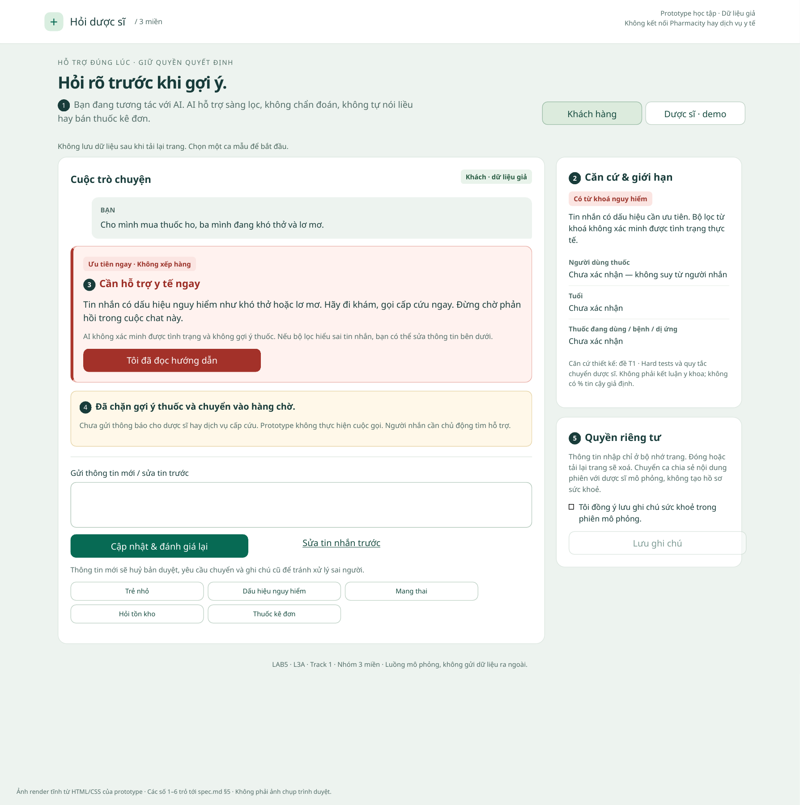

# Bài nộp LAB5 — T1 — Y tế · Nhóm 3 miền

**Trạng thái:** Khung bài, chưa hoàn thành.
**Lớp:** L3A · **Bàn / zone:** Chưa bổ sung · **Track:** T1

| Họ và Tên | Mã Học Viên | Việc đã làm |
|---|---|---|
| Phan Trọng Hậu | 2A202603547 | Dựng prototype HTML/CSS/JS hai màn hình, luồng chuyển/duyệt/quá hạn/sửa tin và quyền riêng tư; tạo 2 ảnh render đánh số; viết §5 và hướng dẫn demo; 17 kiểm tra logic/DOM đạt |
| Ngô Đức Thịnh | 2A202603548 | Chưa ghi nhận |
| Bùi Gia Huy | 2A202603525 | Chưa ghi nhận |

**Phân công dự kiến:** Hậu — prototype, tích hợp và §5; Thịnh — phạm vi, kịch bản, UX khi sai (§1–3); Huy — mức tự chủ, kiểm tra và demo (§4, §6–7). Cả nhóm cùng chốt quyết định. Xem [kế hoạch chi tiết](PHAN_CONG.md); bảng trên chỉ cập nhật việc thực tế đã làm.

## §1. Lát cắt & phạm vi
- **Lát cắt được giao:** Trong **kênh chat Hỏi dược sĩ của Pharmacity**, khi **khách** đang nhắn hỏi "tôi (hoặc người nhà) bị X, có thuốc gì không", **AI tự trả lời và gợi ý sản phẩm, hỏi thêm câu sàng lọc, hay chuyển dược sĩ, khuyên đi khám ngay**, để người dùng thuốc không nhận sai sản phẩm và ca nguy hiểm không nằm trong hàng chờ.
- 3 việc tính năng KHÔNG làm, mỗi việc một câu vì sao.

## §2. Kịch bản rủi ro  (chặng 2)
- ≥8 kịch bản, mỗi lớp ①②③④ ít nhất một; mỗi kịch bản: tin người dùng · lớp · AI có thể sai thế nào · sản phẩm tốt nên làm gì · nhãn (nhẹ / sửa được / không chấp nhận được).
- Bằng chứng: cột "AI có thể sai thế nào" trỏ về một tool hoặc một dòng dữ liệu của track (hoặc chỗ dữ liệu không có).
- Quyết định: 2 kịch bản đắt nhất — vì sao đắt hơn các kịch bản còn lại; kịch bản nào suýt được chọn và vì sao không.

## §3. Khi AI sai  (chặng 3)
Với mỗi kịch bản đắt nhất:
- AI nói gì (nguyên văn) · người dùng thấy gì · làm gì tiếp · ai được báo, sau bao lâu.
- Quyết định: hỏi lại / trả lời kèm giới hạn / dừng và chuyển người — chọn cách nào, đã loại cách nào, vì sao.
- Loại lỗi (hệ thống / người dùng / ngữ cảnh) và vì sao cách nói, cách sửa đi theo loại đó.
- 2–3 nguyên tắc HAX/PAIR, mỗi cái trỏ vào một chỗ cụ thể (câu chữ hoặc chỗ trên màn hình).
- Lỗi nào sửa câu chữ không cứu được (nếu có), và thiết kế cứu nó thế nào.

## §4. Mức tự chủ  (chặng 4)
Với mỗi tool:
- Mức của nhóm (tự làm / cần người duyệt / cấm). Nếu cần người duyệt: ai duyệt · người duyệt thấy gì · quá hạn thì sao.
- Lý do theo cost-of-error: sai thì ai chịu gì · đảo lại được không · chờ người thì mất gì.
- Phương án đã cân nhắc và vì sao loại.
Thêm:
- Tool khó xếp nhất: mỗi người từng chọn gì, cái giá của mỗi phía (trỏ về kịch bản ở §2), nhóm chốt thế nào.
- Thử mức đã đặt trên 2 kịch bản đắt nhất + 1 kịch bản bình thường: cái sai có bị chặn không? còn việc nào làm khi lẽ ra phải hỏi? người dùng bình thường có phải chờ vô ích không?
- Luật thêm hoặc tool tách bước (nếu có), và vì sao.
- Một mức tự chủ đã đổi lời hứa nào với người dùng.

## §5. Prototype  (chặng 5)

### File và phạm vi

- **Mở:** [`prototype/index.html`](prototype/index.html) trực tiếp bằng trình duyệt; [hướng dẫn chạy và demo](prototype/README.md).
- **Công cụ:** HTML/CSS/JavaScript thuần, không cần build; Node.js và jsdom chỉ phục vụ kiểm tra. Hai màn hình: khách hỏi thuốc và bàn dược sĩ mô phỏng.
- **Mock:** toàn bộ phân luồng, hàng chờ, dược sĩ, phê duyệt và ghi chú. Không backend, không kết nối Pharmacity/cấp cứu, không giao dịch. **Không có lời gọi AI thật.** Dữ liệu giả ở bộ nhớ phiên, tải lại trang là xoá.
- **Ca thể hiện:** trẻ 2 tuổi sốt cần người đánh giá; người nhà khó thở/lơ mơ lẫn trong câu mua thuốc. Đây là hai ca dựng để triển khai; Thịnh và Huy cần đối chiếu với hai ca được nhóm chốt ở §2–4.

### Ảnh đánh số và nguyên tắc

Ảnh render tĩnh từ cùng HTML/CSS với ứng dụng, có bố cục in; **không phải ảnh chụp trình duyệt**. Các số cũng xuất hiện trong prototype bấm được. Ba nguyên tắc đang dùng để dựng là **G1, G10, G9**; Thịnh đối chiếu khi hoàn thiện §3.

| Số | Vị trí và điều người dùng thấy | Nguyên tắc | Quyền được thể hiện |
|---|---|---|---|
| 1 | Giới thiệu rõ đang tương tác với AI; không chẩn đoán, tự nói liều hay bán thuốc kê đơn | G1 — Làm rõ hệ thống làm được gì | Giới hạn quyền ngay trước cuộc chat |
| 2 | Bảng căn cứ ghi dữ kiện còn thiếu và lý do chuyển; không hiển thị % chắc chắn không được đo | G10 — Thu hẹp phạm vi khi nghi ngờ | Chưa đủ dữ kiện thì không tự gợi ý sản phẩm; không bịa tồn kho |
| 3 | Ca nguy hiểm hiện cảnh báo ngay; ca khác có biểu mẫu bổ sung/sửa người dùng thuốc; cuối cuộc chat có sửa tin và đánh giá lại | G10 và G9 — Sửa dễ dàng | Tự cảnh báo; sửa dữ kiện huỷ xử lý cũ trước khi phân luồng lại |
| 4 | Ca thường chuyển dược sĩ, có huỷ trước khi nhận; ca nguy hiểm không có nút vào hàng chờ | G9; đường lui khi AI chưa thể giải quyết | Chuyển có thể huỷ khi chưa nhận; không tự nhận quyền tư vấn lúc quá hạn |
| 5 | Lưu ghi chú chỉ mở sau đồng ý riêng; có xoá ghi chú | G9 — Gỡ thông tin đã lưu dễ dàng | Cần khách đồng ý; không mặc định tạo hồ sơ từ việc chuyển ca |
| 6 | Dược sĩ thấy nội dung ca, dữ kiện thiếu và bản nháp; cần tích xác nhận rồi duyệt mới gửi | G10 — Chuyển quyết định sang người khi thiếu căn cứ | Soạn nháp không đồng nghĩa gửi; người duyệt là dược sĩ mô phỏng |

### Quyết định thiết kế và phương án đã loại

1. **Dùng căn cứ cụ thể thay thang % tin cậy.** Đã cân nhắc nhãn “AI chắc 90%”; loại vì prototype không có phép đo để chứng minh. Chọn bảng “ai dùng thuốc / tuổi / thuốc, bệnh, dị ứng còn thiếu” và lý do chuyển để người dùng kiểm tra được điều AI chưa biết (vị trí 2).
2. **Cảnh báo nguy hiểm thay cho hàng chờ.** Đã cân nhắc ưu tiên ca trong hàng dược sĩ; loại vì vẫn khiến khách tưởng nên chờ. Chọn cảnh báo ngay, không hiện gợi ý thuốc hoặc nút vào hàng chờ, nói rõ chưa có dịch vụ nào được báo (vị trí 3–4). Sửa câu chữ không cứu được lỗi xếp nhầm ca nếu nút chuyển vẫn hoạt động; cần chặn cả thao tác trong logic.
3. **Duyệt bản nháp ở màn dược sĩ thay cho khách bấm “đồng ý mua”.** Khách không thay được đánh giá chuyên môn. Bàn dược sĩ hiển thị dữ kiện trước khi duyệt; nháp chỉ là phản hồi sàng lọc, không phải gợi ý sản phẩm. Quá hạn 2 phút tính từ lúc chuyển ca sẽ vô hiệu nháp, không tự gửi (vị trí 6). Không giả vờ có giao dịch hoặc dược sĩ thật.
4. **Sửa thông tin phải huỷ quyết định cũ.** Đã cân nhắc giữ nguyên ca và bản nháp sau tin mới; loại vì có thể áp câu trả lời cho sai người dùng thuốc. Tin mới hoặc cập nhật biểu mẫu sẽ đánh giá lại; dữ kiện mới có từ khoá nguy hiểm lập tức chuyển sang cảnh báo. Đồng ý lưu và ghi chú cũ cũng được xoá để xin lại đúng ngữ cảnh.
5. **Đồng ý lưu tách khỏi chuyển ca.** Đã cân nhắc tự lưu để lần sau tiện hơn; loại vì thông tin sức khoẻ nhạy cảm. Khách được biết nội dung chia sẻ khi chuyển và chỉ tạo ghi chú phiên sau đồng ý riêng; có nút xoá (vị trí 5).

### Tự chủ hiện có để đối chiếu §4

- `khuyen_di_kham`: tự hiển thị cảnh báo khi khớp từ khoá nguy hiểm; nút đã đọc không thực hiện cuộc gọi.
- `chuyen_duoc_si`: xử lý tự động sau khi khách chủ động chọn chuyển, có huỷ trước khi nhận. Ca nguy hiểm không đi đường này.
- `luu_ghi_chu_suc_khoe`: cần khách đồng ý riêng; mô phỏng ghi chú trong bộ nhớ phiên, không hồ sơ bền vững.
- `ban_thuoc_ke_don`: cấm, không có nút bán hoặc thay thế.
- `goi_y_san_pham`: AI không tự gửi; prototype chưa triển khai bước dược sĩ chọn sản phẩm. Luồng duyệt hiện tại chỉ dành cho phản hồi sàng lọc.
- Tách thao tác mô phỏng **soạn phản hồi sàng lọc** khỏi **gửi phản hồi đã duyệt** để chứng minh bản nháp không được tự phát hành. Huy cần ghi rõ hai thao tác bổ sung nếu giữ thiết kế này trong §4.

Các mức trên là giả định triển khai cần Huy đối chiếu/chốt ở §4, không phải lịch sử thảo luận đã diễn ra.

### Kiểm tra và giới hạn

- **17/17 kiểm tra đạt:** 13 logic + 4 DOM bằng jsdom. Có kiểm tra ưu tiên dấu hiệu nguy hiểm, chuyển/huỷ, chặn gửi trước xác nhận, quá hạn, sửa dữ kiện, đồng ý lưu và chèn HTML.
- Đã render, xem lại 2 ảnh bố cục. Không có trình duyệt khả dụng trong môi trường thực hiện nên **chưa kiểm tra trực tiếp layout responsive, focus/scroll, hẹn giờ thực tế và thao tác trên trình duyệt thật**.
- Từ khoá chỉ phục vụ demo, có thể bỏ sót cách diễn đạt hoặc nhận nhầm phủ định (“không khó thở”). Ca lạ không được nhận diện đi đường hỏi lại/chuyển người; điều này không bảo đảm phát hiện cấp cứu. Không dùng prototype cho tư vấn thật.
- Đổi vai là điều khiển demo, không có xác thực hay phân quyền sản phẩm. Hạn 2 phút là giả định, không phải SLA của Pharmacity. Không tính bonus lời gọi AI thật.

## §6. Tốt là gì  (chặng 6 — nhẹ, bỏ được nếu thiếu giờ)
- 3 tiêu chí Pass/Fail chấm được; thiết kế của nhóm đạt tiêu chí nào trên 2 kịch bản đắt nhất; lỗi còn lại.

## §7. Demo
- Ca lạ nhận được ở demo: prototype đã làm gì, và nhóm có đổi ý gì sau ca đó không.
